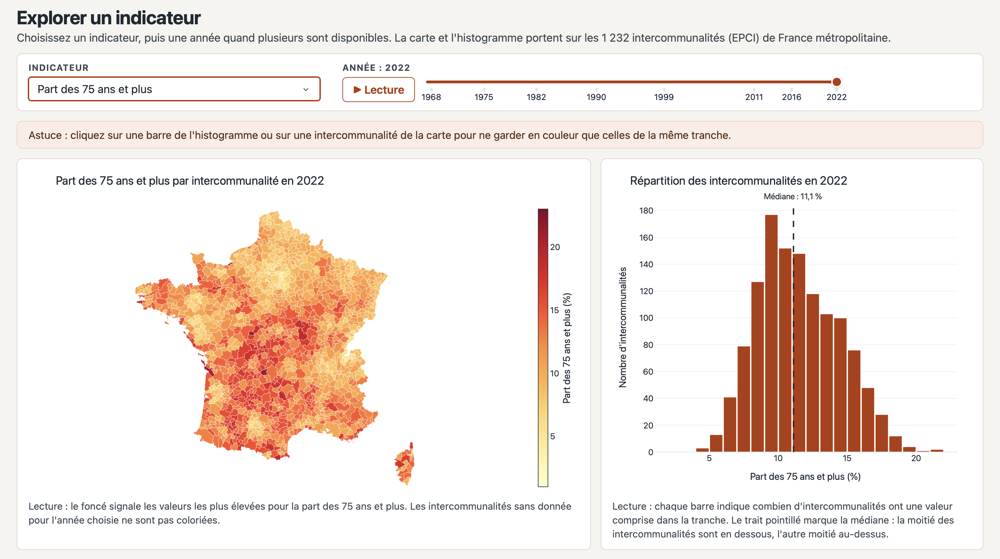
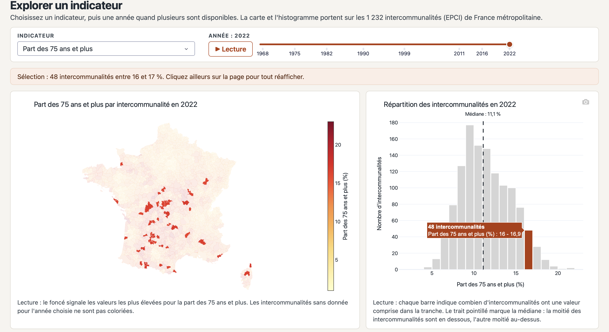
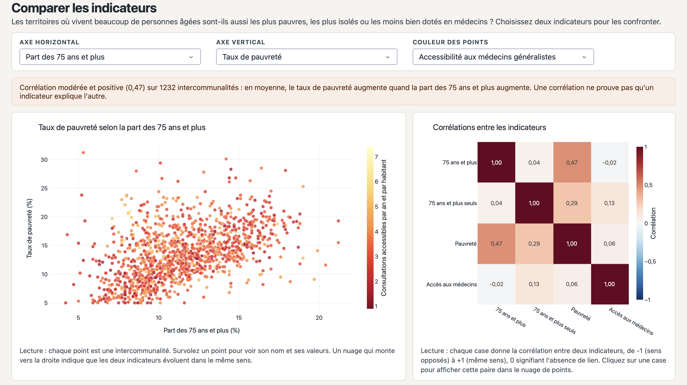
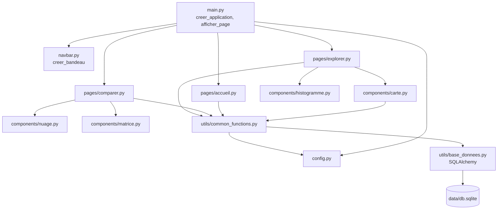
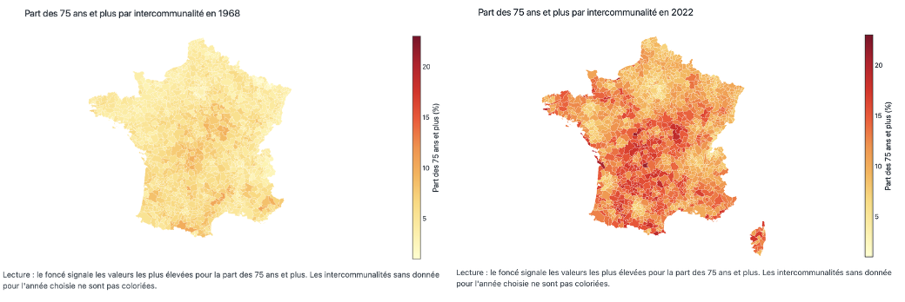
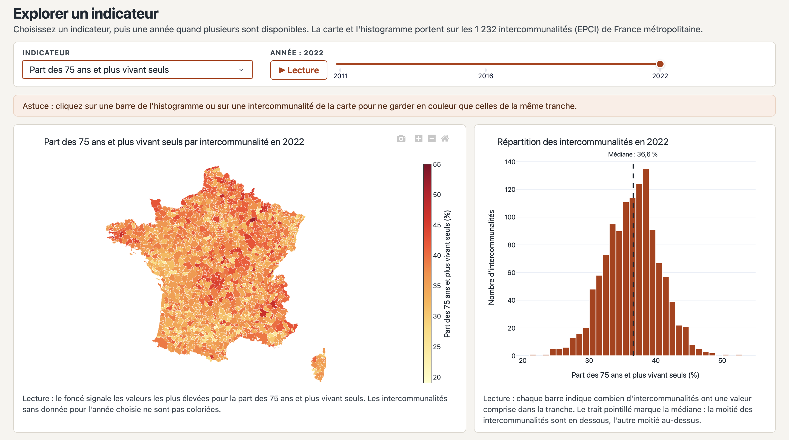
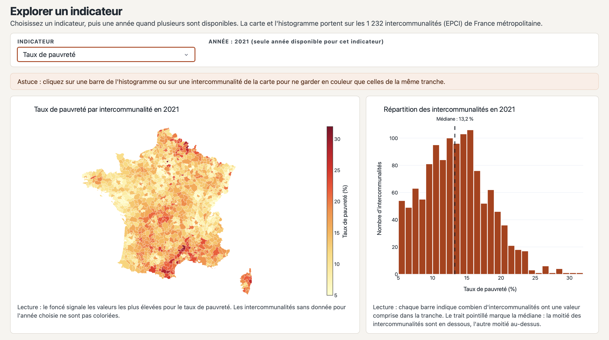
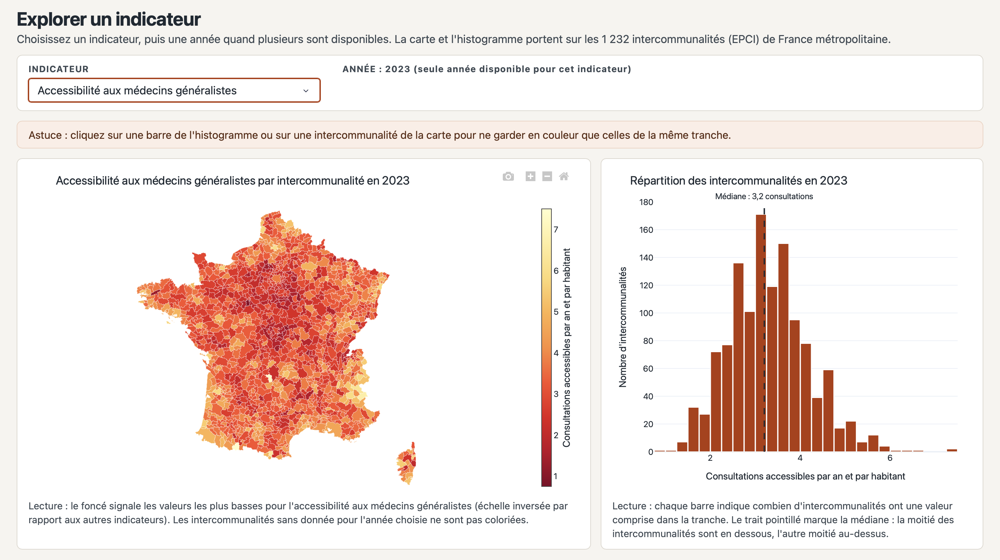

# Vieillir en France : où sont les territoires fragiles ?

Dashboard interactif sur la situation des personnes âgées dans les 1 232 intercommunalités (EPCI) de France métropolitaine : vieillissement de la population depuis 1968, isolement des 75 ans et plus, pauvreté et accès aux médecins généralistes.

Projet réalisé par **Lilou Parrin** et **Noémie Graignac** (ESIEE Paris, E4 DSIA, Python 2).



---

## User Guide

### Vidéo de démonstration

[Voir la vidéo de démonstration](https://youtu.be/vwSOfejsFXE) (4 minutes)

### Prérequis

- [git](https://git-scm.com/)
- [uv](https://docs.astral.sh/uv/), qui installe automatiquement la bonne version de Python (3.14) et les dépendances

### Installation et lancement

```bash
git clone https://git.esiee.fr/parrinl/dataproject.git dataproject
cd dataproject
uv sync
uv run python main.py
```

Ouvrir ensuite l'adresse affichée dans le terminal, [http://127.0.0.1:8050](http://127.0.0.1:8050), dans un navigateur. Pour arrêter le dashboard : `Ctrl+C` dans le terminal.

Le dashboard fonctionne **sans connexion internet** : les données nécessaires sont déjà dans le dépôt (`data/db.sqlite` et `data/cleaned/`).

### Reconstruire les données (facultatif)

Pour retélécharger les sources et refaire le nettoyage :

```bash
uv run python -m src.utils.get_data
uv run python -m src.utils.clean_data
```

Depuis la mise à jour de l'Observatoire des territoires du 9 octobre 2026, ses fichiers ne sont plus téléchargeables dans le découpage utilisé : `get_data.py` le signale et reconstruit les tables à l'identique à partir des fichiers d'origine conservés dans `data/raw/`.

### Utilisation

Le bandeau du haut permet de passer d'une page à l'autre. Sur toutes les cartes et tous les graphiques, la règle de lecture est la même : **plus la couleur est foncée, plus le territoire est fragile**.

**Page Accueil** : la question posée, les chiffres clés calculés à partir des données, les principales conclusions et les liens vers les deux autres pages.

**Page Explorer** : une carte et un histogramme pour un indicateur.

- Le menu **Indicateur** choisit l'un des quatre indicateurs.
- Le **curseur d'années** choisit le recensement à afficher, quand plusieurs années existent.
- Le bouton **▶ Lecture** fait défiler les années automatiquement, pour les indicateurs disponibles sur plusieurs années : de 1968 à 2022 pour la part des 75 ans et plus, et de 2011 à 2022 pour la part des 75 ans et plus vivant seuls. Il n'apparaît pas pour le taux de pauvreté et l'accès aux médecins, qui n'ont qu'une année.
- Un **clic sur une barre** de l'histogramme ne garde en couleur, sur la carte, que les intercommunalités de cette tranche.
- Un **clic sur une intercommunalité** de la carte affiche sa valeur et met en évidence sa tranche dans l'histogramme.
- Un **clic ailleurs sur la page** réaffiche tout.



**Page Comparer** : les liens entre les indicateurs.

- Trois menus choisissent l'indicateur en abscisse, celui en ordonnée et celui qui colorie les points.
- Le **nuage de points** place chaque intercommunalité selon les deux indicateurs ; son nom s'affiche au survol.
- La **phrase au-dessus des graphiques** décrit la corrélation entre les deux indicateurs choisis.
- La **matrice des corrélations** résume tous les liens ; un clic sur une case affiche cette paire dans le nuage.



---

## Data

### Sources

Toutes les données sont publiques, en open data, téléchargées sur l'[Observatoire des territoires](https://www.observatoire-des-territoires.gouv.fr/) (ANCT) au niveau des EPCI dans leur découpage 2025. Les adresses de téléchargement suivent toutes le même modèle, défini dans `config.py` :

```
https://www.observatoire-des-territoires.gouv.fr/outils/cartographie-interactive/api/v1/functions/GC_API_download.php?type=stat&nivgeo=epci2025&dataset={base}&indic={indicateur}
```

| Fichier | `dataset` / `indic` | Producteur | Année(s) |
|---|---|---|---|
| Part des 75 ans et plus | `insee_rp_hist_1968` / `part_pop75p` | Insee, recensements de la population | 1968 à 2022 (8 recensements) |
| Nombre de 75 ans et plus | `insee_rp_hist_1968` / `pop75p` | Insee, recensements de la population | 1968 à 2022 |
| Nombre de 75 ans et plus vivant seuls | `indic_sex_rp` / `nb_persseul75` | Insee, recensements de la population | 2011, 2016, 2022 |
| Taux de pauvreté au seuil de 60 % | `filosofi` / `tx_pauv_60` | Insee, Filosofi (données fiscales et sociales) | 2021 |
| Accessibilité potentielle localisée aux médecins généralistes | `apl` / `apl_mg_hmep` | DREES | 2023 |

Les données ont été téléchargées début octobre 2026, dans la géographie des EPCI de 2025. L'Observatoire a été mis à jour depuis (recensement 2023, découpage intercommunal 2026) : nous ne les avons pas intégrées en cours de projet, pour garder des codes d'EPCI cohérents entre toutes les sources et le fond de carte.

Contours des EPCI 2025, simplifiés à 100 m : [data.gouv.fr, Contours administratifs](https://www.data.gouv.fr/datasets/contours-administratifs) ([fichier GeoJSON](https://object.data.gouv.fr/contours-administratifs/2025/geojson/epci-100m.geojson)).

### Les quatre indicateurs du dashboard

| Indicateur | Nom dans le projet | Définition | Unité |
|---|---|---|---|
| Part des 75 ans et plus | `part_75_plus` | 75 ans et plus ÷ population totale | % |
| Part des 75 ans et plus vivant seuls | `part_75_seuls` | 75 ans et plus vivant seuls ÷ ensemble des 75 ans et plus (calculé dans `clean_data.py`) | % |
| Taux de pauvreté | `taux_pauvrete` | Part de la population vivant sous le seuil de pauvreté (60 % du niveau de vie médian), tous âges | % |
| Accessibilité aux médecins généralistes | `apl_medecins` | Nombre de consultations ou visites accessibles par an et par habitant | consultations |

**Part des 75 ans et plus.** C'est la part des personnes de 75 ans et plus dans la population totale de chaque EPCI, téléchargée directement sur l'Observatoire. C'est le seul indicateur disponible sur une longue période : huit recensements, de 1968 à 2022. Ces séries historiques sont établies dans le découpage territorial actuel, ce qui permet de suivre un même territoire dans le temps. Le curseur d'années et l'animation de la page Explorer montrent cette évolution sur un demi-siècle. Les 19 EPCI de Corse n'ont pas de valeur en 1968 et 1975.

**Part des 75 ans et plus vivant seuls.** L'indicateur officiel n'étant pas téléchargeable à l'échelle des EPCI, il est recalculé à partir du nombre de 75 ans et plus vivant seuls et du nombre total de 75 ans et plus, tous deux issus du recensement. La définition de l'Insee ne compte au dénominateur que les personnes vivant en logement ordinaire ; la nôtre inclut aussi les personnes résidant en établissement (EHPAD, maisons de retraite). Nos valeurs sont donc un peu plus faibles, mais comparables d'un territoire à l'autre.

**Taux de pauvreté.** Le taux de pauvreté des ménages de 75 ans et plus aurait été plus adapté au sujet. Mais l'Insee ne le diffuse pas quand ces ménages sont trop peu nombreux. Il manquait donc pour environ un tiers des EPCI, surtout de petits territoires ruraux et âgés, précisément ceux au cœur de l'analyse. Nous avons retenu le taux de pauvreté de l'ensemble de la population, disponible pour tous les EPCI.

**Accessibilité aux médecins généralistes.** C'est l'APL (Accessibilité potentielle localisée) calculée par la DREES, dans sa version qui prend en compte tous les médecins quel que soit leur âge. Elle mesure le nombre de consultations ou visites accessibles par an et par habitant, en tenant compte de l'offre des communes voisines (jusqu'à 20 minutes de trajet) et de l'âge de la population, ce qui la rend comparable d'un territoire à l'autre. Contrairement aux trois autres indicateurs, **une valeur élevée est favorable** : c'est pourquoi son échelle de couleurs est inversée dans le dashboard.

### Stockage

| Emplacement | Contenu |
|---|---|
| `data/raw/` | Les fichiers téléchargés en octobre 2026, sans modification (versionnés, puisque l'Observatoire ne les diffuse plus) |
| `data/db.sqlite`, tables `raw_...` | Une table brute par source, contenu tel que téléchargé : 37 640 lignes au total |
| `data/db.sqlite`, tables `cleaned_...` | Une table nettoyée par indicateur : 15 978 lignes au total |
| `data/cleaned/epci_metropole.geojson` | Les contours des 1 232 EPCI de métropole |

La base est lue et écrite avec **SQLAlchemy**, dans le module `src/utils/base_donnees.py`. Elle contient neuf tables :

| Table | Contenu | Lignes |
|---|---|---|
| `raw_part_pop75p` | Part des 75 ans et plus | 10 035 |
| `raw_pop75p` | Nombre de 75 ans et plus | 10 035 |
| `raw_nb_persseul75` | Nombre de 75 ans et plus vivant seuls, par sexe | 15 060 |
| `raw_tx_pauv_60` | Taux de pauvreté | 1 255 |
| `raw_apl_mg_hmep` | Accessibilité aux médecins généralistes | 1 255 |
| `cleaned_part_75_plus` | Part des 75 ans et plus | 9 818 |
| `cleaned_part_75_seuls` | Part des 75 ans et plus vivant seuls, calculée | 3 696 |
| `cleaned_taux_pauvrete` | Taux de pauvreté | 1 232 |
| `cleaned_apl_medecins` | Accessibilité aux médecins généralistes | 1 232 |

Les nombres de 75 ans et plus (`raw_pop75p`) et de 75 ans et plus vivant seuls (`raw_nb_persseul75`) servent ensemble à calculer la part des personnes âgées vivant seules : cinq sources brutes donnent donc quatre tables nettoyées, une par indicateur affiché.

Les tables nettoyées sont au **format long** (une ligne par intercommunalité et par année), parce que les indicateurs ne couvrent pas les mêmes années. Au lancement, le dashboard les rassemble en un seul tableau ; le tableau large, une colonne par indicateur, est reconstruit à la demande pour la page Comparer.

### Nettoyage

- conversion des valeurs, stockées comme du texte, en nombres ;
- conservation du total quand un indicateur est détaillé par sexe ;
- calcul de la part des 75 ans et plus vivant seuls ;
- traitement des faux zéros (EPCI de Mayotte) comme des valeurs manquantes ;
- suppression des lignes sans valeur ;
- restriction à la France métropolitaine, Corse comprise ;
- validation de chaque ligne avec pydantic avant l'écriture dans la base.

### Limites des données

- **Outre-mer exclu** : 23 EPCI, dont les données sont incomplètes (pauvreté absente pour 15 d'entre eux, aucune donnée pour Mayotte).
- **Corse en 1968 et 1975** : pas de valeur pour ses 19 EPCI, ces recensements n'y reposant que sur un sondage.
- **Plancher du taux de pauvreté** : 18 intercommunalités ont exactement 5,0 %, valeur plancher liée au secret statistique.
- **Isolement** : le dénominateur inclut les personnes âgées vivant en établissement (voir la définition ci-dessus), ce qui baisse un peu la part dans les territoires qui comptent beaucoup de places en établissement.
- **Pauvreté tous âges** : le taux de pauvreté porte sur toute la population, pas seulement sur les personnes âgées (voir ci-dessus).
- **Années différentes** : la comparaison utilise la dernière année de chaque indicateur (2021 à 2023).
- **Pas de pondération** : chaque intercommunalité compte autant dans les moyennes et les corrélations, quelle que soit sa population.

---

## Developer Guide

### Architecture

```
dataproject
|-- assets/style.css            # feuille de style, chargée automatiquement par Dash
|-- data/                       # base SQLite (tables raw_... et cleaned_...), fichiers bruts et fond de carte
|-- images/                     # captures d'écran du README
|   |-- explorer.png            # page Explorer
|   |-- selection.png           # sélection d'une tranche sur la page Explorer
|   |-- comparer.png            # page Comparer
|   |-- vieillissement.png      # cartes de 1968 et de 2022 (rapport d'analyse)
|   |-- isolement.png           # carte de l'isolement en 2022 (rapport d'analyse)
|   |-- pauvrete.png            # carte de la pauvreté en 2021 (rapport d'analyse)
|   |-- medecins.png            # carte de l'accès aux médecins en 2023 (rapport d'analyse)
|-- src/
|   |-- components/             # graphiques et éléments réutilisables
|   |   |-- carte.py            # carte choroplèthe des EPCI
|   |   |-- histogramme.py      # histogramme d'un indicateur
|   |   |-- nuage.py            # nuage de points (Plotly Express)
|   |   |-- matrice.py          # matrice des corrélations (Plotly Express)
|   |   |-- navbar.py           # bandeau et liens vers les pages
|   |-- pages/
|   |   |-- accueil.py          # page Accueil : chiffres clés et conclusions
|   |   |-- explorer.py         # page Explorer et ses callbacks
|   |   |-- comparer.py         # page Comparer et ses callbacks
|   |-- utils/
|       |-- get_data.py         # téléchargement, une table raw_... par source
|       |-- clean_data.py       # nettoyage, une table cleaned_... par indicateur
|       |-- validation.py       # modèle pydantic des données nettoyées
|       |-- base_donnees.py     # accès à la base SQLite avec SQLAlchemy
|       |-- common_functions.py # lecture de la base et calculs partagés
|-- tests/                      # tests unitaires (pytest)
|   |-- test_get_data.py        # récupération des sources et repli sur la copie locale
|   |-- test_clean_data.py      # nettoyage des données
|   |-- test_validation.py      # validation pydantic
|   |-- test_base_donnees.py    # lecture et écriture de la base (SQLAlchemy)
|   |-- test_common_functions.py # fonctions partagées
|   |-- test_graphics.py        # composants graphiques
|   |-- test_matrice.py         # matrice des corrélations
|   |-- test_explorer.py        # logique de la page Explorer
|   |-- test_comparer.py        # logique de la page Comparer
|-- config.py                   # tous les paramètres du projet
|-- main.py                     # point d'entrée et navigation entre les pages
```

Le code suit une programmation impérative : des fonctions, regroupées en modules, appelées depuis `main.py` ou par les callbacks de Dash.

### Structure du dashboard



### Principes

- **Tout ce qui se règle est dans `config.py`** : sources, chemins, indicateurs, pages, couleurs, dimensions des graphiques.
- **Un composant = une fonction qui renvoie une figure** (`creer_carte`, `creer_histogramme`, `creer_nuage`, `creer_matrice`), sans callback.
- **Une page = un module** avec une fonction `creer_mise_en_page()` et ses callbacks.
- **Les décisions des callbacks sont dans des fonctions séparées** (`piloter_animation`, `selectionner_tranche`, `texte_correlation`...), testables sans navigateur.
- **La carte est mise à jour partiellement** (`Patch`) : le fond de carte n'est envoyé au navigateur qu'une fois, ce qui garde l'animation fluide.
- **Données statiques** : pas de rafraîchissement ; les tables sont simplement gardées en mémoire après la première lecture (`lru_cache`).
- **Un seul point d'accès à la base** : toutes les lectures et écritures passent par `base_donnees.py`. Il crée un moteur SQLAlchemy relié au fichier SQLite (`creer_moteur`), puis enregistre et relit les tables avec `to_sql` et `read_sql_table` de pandas (`ecrire_table`, `lire_table`). Les autres modules ne manipulent jamais la base directement.

### Ajouter une page

1. Créer `src/pages/ma_page.py` avec une fonction `creer_mise_en_page() -> html.Div` et, si besoin, ses callbacks (décorateur `@callback`).
2. Dans `main.py`, importer le module et l'ajouter au dictionnaire `PAGES` :
   ```python
   PAGES = {
       "/": accueil.creer_mise_en_page,
       "/explorer": explorer.creer_mise_en_page,
       "/comparer": comparer.creer_mise_en_page,
       "/ma-page": ma_page.creer_mise_en_page,
   }
   ```
3. Dans `config.py`, ajouter le lien à `NAVIGATION` : `"/ma-page": "Ma page"`.

### Ajouter un graphique

1. Créer `src/components/mon_graphique.py` avec une fonction qui reçoit des données et renvoie une `go.Figure` (titre, axes nommés, `config.POLICE_GRAPHIQUES`).
2. L'appeler dans la page, dans un `dcc.Graph(id="mon-graphique")`.
3. Si le graphique doit réagir aux réglages, ajouter un callback avec `Output("mon-graphique", "figure")`.

### Ajouter un indicateur

1. Trouver ses codes `dataset` et `indic` dans l'adresse de téléchargement de l'Observatoire, et l'ajouter à `SOURCES_OBSERVATOIRE` dans `config.py`.
2. Dans `clean_data.py`, l'ajouter au dictionnaire de `construire_table_nettoyee`, sous son nom définitif.
3. Dans `config.py`, le décrire dans `INDICATEURS` (noms, unité, largeur des tranches, et `echelle_inversee=True` si une valeur basse est défavorable).
4. Relancer `get_data` puis `clean_data` : il apparaît automatiquement dans les menus des deux pages.

### Outils de développement

```bash
uv sync --group dev              # installe aussi ruff et pytest
uv run --group dev ruff check .  # bonnes pratiques
uv run --group dev ruff format . # mise en forme
uv run --group dev pytest        # tests unitaires
```

---

## Rapport d'analyse

Toutes les moyennes et corrélations ci-dessous sont calculées par intercommunalité, sans pondération par la population.

### 1. La France vieillit, et le vieillissement se concentre au centre et au sud-ouest

La part moyenne des 75 ans et plus est passée de **5,4 % en 1968 à 11,4 % en 2022** : elle a doublé en un demi-siècle. La médiane passe de 5,3 % à 11,1 %, et l'histogramme s'élargit : en 1968, presque toutes les intercommunalités étaient entre 2 et 10 % ; en 2022, elles vont de 4,2 % (CC Plaines et Monts de France) à 21,2 % (CC du Châtillonnais en Berry).

L'animation montre que la géographie du vieillissement est ancienne. Dès 1968, les territoires un peu plus âgés se trouvent au centre de la France, dans le piémont pyrénéen et en Provence. En 1990, une diagonale se dessine du Centre et du Limousin vers le Sud-Ouest, avec quelques foyers en Bretagne. En 2022, cette diagonale est nettement marquée (Centre, Limousin, Massif central, Dordogne, Lot), et le littoral atlantique (Charente-Maritime), les côtes bretonnes et la Normandie se sont aussi assombris. Les territoires restés les plus jeunes sont l'Île-de-France, les grandes agglomérations (Lyon, Toulouse), les Alpes du Nord et une partie du Nord-Est.



### 2. Un isolement stable, plus marqué au nord, à l'est et dans les villes

En moyenne, **36 % des 75 ans et plus vivent seuls**, une valeur quasiment inchangée en 2011, 2016 et 2022 (médiane 36,6 % en 2022). Elle varie de 21 % à 52 % selon les territoires.

Sa géographie diffère de celle du vieillissement : l'isolement est plus élevé dans le Nord et les Ardennes, le Nord-Est, une partie du Centre et sur la côte méditerranéenne, et plus faible dans l'Ouest (Pays de la Loire, Poitou-Charentes) et une partie du Sud-Ouest. Plusieurs foyers correspondent à des agglomérations, où les personnes âgées vivent plus souvent seules.



### 3. La pauvreté se concentre au nord et sur le pourtour méditerranéen

Le taux de pauvreté moyen est de **13,5 %** en 2021 (médiane 13,2 %), de 5 % à 31,2 % (CA Creil Sud Oise). Les territoires les plus pauvres forment deux ensembles : le Nord et les Ardennes, le long de la frontière belge, et le pourtour méditerranéen (Languedoc-Roussillon, Pyrénées-Orientales, Gard, Vaucluse), auxquels s'ajoutent quelques territoires du Centre et de la Corse. L'Ouest, l'Île-de-France hors pôles urbains, l'Alsace et les Alpes du Nord sont les moins touchés.



### 4. Les déserts médicaux se situent surtout au centre du Bassin parisien

L'accessibilité moyenne aux médecins généralistes est de **3,3 consultations par an et par habitant** (médiane 3,2), de 0,9 (CC des Collines du Perche) à 7,4. L'accès le plus faible se trouve dans une large zone autour de l'Île-de-France et au centre de la France : Centre-Val de Loire, Bourgogne, Normandie intérieure, nord du Massif central. Les littoraux atlantique et méditerranéen, les Alpes et les Pyrénées sont mieux dotés.



### 5. Les liens entre indicateurs

| Paire d'indicateurs | Corrélation | Lecture |
|---|---|---|
| Âge et pauvreté | **0,47** | Lien modéré : les territoires âgés sont plus souvent pauvres |
| Isolement et pauvreté | 0,29 | Lien faible |
| Isolement et accès aux médecins | 0,13 | Pratiquement aucun lien |
| Pauvreté et accès aux médecins | 0,06 | Aucun lien |
| Âge et isolement | 0,04 | Aucun lien |
| Âge et accès aux médecins | -0,02 | Aucun lien |

Le seul lien net est celui entre vieillissement et pauvreté, et le nuage de points reste large : à âge égal, la pauvreté varie beaucoup. Le vieillissement, l'isolement et l'accès aux médecins sont en revanche trois fragilités distinctes, qui ne se trouvent pas aux mêmes endroits. Les cartes le confirment : la diagonale du vieillissement, les foyers d'isolement du nord et de l'est, et les déserts médicaux du Bassin parisien ne se superposent pas.

### 6. Des territoires qui cumulent les difficultés

L'absence de lien d'ensemble n'empêche pas certains territoires de cumuler les fragilités. **46 intercommunalités** font partie à la fois du quart le plus âgé (au moins 13,5 % de 75 ans et plus), du quart le plus pauvre (au moins 16,5 %) et du quart le moins bien doté en médecins (au plus 2,6 consultations). **Dix d'entre elles** font aussi partie du quart où l'isolement est le plus fort (au moins 39 %), par exemple :

| Intercommunalité | 75 ans et plus | Pauvreté | Accès aux médecins | Vivant seuls |
|---|---|---|---|---|
| CC de la Marche Berrichonne | 18,8 % | 20,5 % | 2,3 | 40,7 % |
| CC Causses Aigoual Cévennes | 14,5 % | 28,3 % | 1,9 | 40,3 % |
| CC Monts d'Arrée Communauté | 13,9 % | 21,0 % | 1,3 | 40,4 % |
| CC Morvan Sommets et Grands Lacs | 17,9 % | 17,8 % | 2,0 | 41,3 % |
| CC Creuse Confluence | 15,9 % | 20,1 % | 2,6 | 42,4 % |

Ces territoires sont presque tous ruraux et situés au centre de la France (Berry, Creuse, Morvan, Limousin), dans le Massif central et ses marges (Cévennes, Aveyron, Cantal) ou dans le Sud-Ouest (Dordogne, Lot, Lot-et-Garonne), avec quelques cas en Corse et en Bretagne intérieure.

### Conclusion

La France vieillit partout, mais surtout selon une diagonale qui va du Centre au Sud-Ouest. Ce vieillissement va de pair avec la pauvreté, alors que l'isolement et l'accès aux médecins suivent leur propre géographie. Les territoires les plus fragiles sont donc ceux, surtout ruraux et situés au centre de la France, où ces difficultés se cumulent.

Ces résultats restent à nuancer : une corrélation ne prouve pas une cause, la pauvreté est mesurée sur tous les âges, et les indicateurs ne datent pas tous de la même année.

---

## Copyright

Nous déclarons sur l'honneur que le code fourni a été produit par nous-mêmes, à l'exception des éléments déclarés ci-dessous. Toute ligne non déclarée ci-dessous est réputée produite par les auteurs du projet.

### Notre contribution

Le projet a été conçu, piloté et vérifié par nous. Les décisions suivantes viennent de nous :

- **Le sujet et les indicateurs** : l'étude de la vulnérabilité des personnes âgées par intercommunalité, à partir de quatre indicateurs (vieillissement, isolement, pauvreté, accès aux médecins) que nous avions déjà identifiés et travaillés.
- **La méthode de calcul de l'isolement** : le rapport entre le nombre de 75 ans et plus vivant seuls et l'ensemble des 75 ans et plus, que nous avions construit auparavant, ainsi que le choix du taux de pauvreté tous âges face au secret statistique.
- **La recherche des sources** : l'identification des indicateurs sur l'Observatoire des territoires, la récupération et le test de chaque adresse de téléchargement, et le choix du fond de carte sur data.gouv.fr.
- **La conception de l'interface** : la sélection liée entre la carte et l'histogramme, inspirée de la sélection dans GeoDa ; la carte et l'histogramme côte à côte ; la sélection au clic plutôt qu'au survol ; le retour à l'affichage complet par un clic ailleurs ; l'apparence (fond beige, curseur rouge et plus court, notes de lecture) ; les titres lisibles (« intercommunalité » plutôt qu'« EPCI ») ; l'ajout d'une page de comparaison entre indicateurs et de l'animation des années.
- **Les tests et les corrections** : chaque version a été installée et testée dans le navigateur. Nous avons repéré et fait corriger les problèmes : cadrage de la carte, barre de l'histogramme mise en évidence par erreur, sélection impossible à annuler, clic sur une intercommunalité sans effet, mise en page qui ne se chargeait pas sur une autre machine. Nous avons aussi discuté et validé les choix de lecture, comme l'échelle de couleurs inversée pour l'accès aux médecins.
- **L'analyse** : la lecture des cartes et des graphiques, l'interprétation des corrélations et les conclusions du rapport d'analyse.


### Utilisation de l'intelligence artificielle

Nous avons utilisé **Claude (Anthropic)** et **ChatGPT (OpenAI)** pour nous aider à rédiger et à améliorer le README, à tester les fonctions du projet et à optimiser certaines fonctions. Les propositions ont été relues, vérifiées et adaptées par nous même.

### Prompts les plus structurants

1. **Choix du sujet** : réutiliser nos indicateurs sur le vieillissement, l'isolement, la pauvreté et l'accès aux médecins par EPCI pour construire un dashboard Python.
2. **Récupération et nettoyage** : « On garde les différentes années pour avoir un curseur d'années montrant le vieillissement de la France sur 50 ans, et on reste sur la métropole. »
3. **Interaction** : « Si on clique sur une barre de l'histogramme, la carte se grise sauf les EPCI concernés, et si on clique sur un EPCI, sa barre est mise en évidence, comme dans GeoDa quand on sélectionne des lignes de la table. »
4. **Nouvelles consignes** : passer à une table `raw` et une table `cleaned` par source de données, avec un accès à la base par SQLAlchemy, sans modifier les données affichées.


### Sources externes

- Documentation de [Dash](https://dash.plotly.com/), [Plotly](https://plotly.com/python/) et [pydantic](https://docs.pydantic.dev/).
- Cours Python 1 et Python 2 de D. Courivaud (ESIEE Paris).
